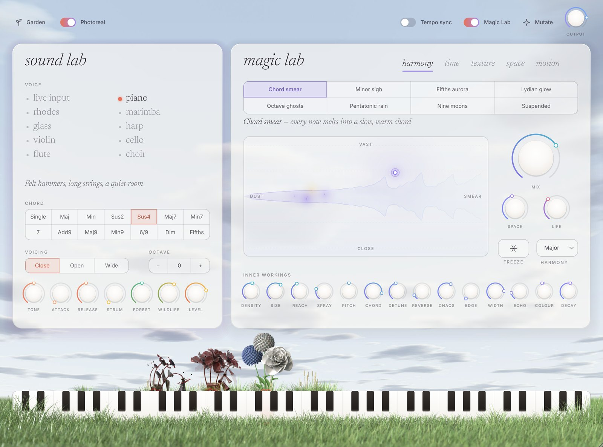

# Bouquet

A granular instrument for macOS (AU + VST3, universal, macOS 11+; VST3 on Windows and Linux too).
Recordings of real instruments on the left, played as if in a forest clearing; a granular Magic Lab
on the right; and a garden that grows a bouquet for every chord you play, then lets it rot.



| Plugin | |
| --- | --- |
| **Bouquet** | instrument (+ standalone app) |
| **Bouquet FX** | the same engine as an effect, granulating the track it's on |

## Install (Mac)

1. Download **Bouquet-macOS.pkg** from the [latest release](https://github.com/1A12L5E24X/vst3-test/releases/latest)
   (or, for the newest build, from the Artifacts of the latest green run in the
   [Actions tab](https://github.com/1A12L5E24X/vst3-test/actions)).
2. Open it. The installer isn't notarized yet, so macOS may say it can't check it: open
   **System Settings → Privacy & Security**, scroll down and click **Open Anyway**.
3. Rescan plug-ins in your DAW. In Ableton: Settings → Plug-Ins → "Use Audio Units" → Rescan.
   Bouquet goes on a MIDI track, Bouquet FX on an audio track. In Logic they're under Audio Units → Bouquet.

The installer also removes Murmur, Simple Synth and Bouquet Real from older test builds.

## Using it

- **Sound Lab**: piano, rhodes, marimba, harp, violin, cello and flute are recordings of real
  instruments; glass and choir are synthesised; or use live input. One finger plays a whole chord
  (shape, voicing, strum). **forest** and **wildlife** set how deep in the trees you are and how much
  of the forest you hear.
- **Magic Lab**: 40 granular spells (chord smear, frozen breath, shimmer halo…). Click one and everything
  glides there. Drag the aura pad, hit **freeze**, **mutate**. The on/off switch bypasses it and folds it away.
  **tempo sync** locks the grains to your DAW's beat grid (the grain rate snaps to the nearest note
  length, straight or triplet) and makes echoes land on whole note lengths.
- **Expression**: press into held keys (aftertouch, channel or polyphonic) to swell and brighten a note
  and lift its flowers; the mod wheel blows wind through the grains and the garden. The recordings
  cross-fade smoothly between soft and loud layers, and no two notes are played quite the same.
- **The garden**: grass springs up under the keys you play and every chord grows a bouquet that rots when
  you let go. **photoreal / drawn** switches between 3D-rendered and illustrated flowers.
- **Presets**: click **garden** to look down on a lawn where every preset is a flower. Hover to see a name,
  click to load, **plant this sound** to save yours as a new flower. Right-click to uproot.

## Building

```sh
cmake -S . -B build -DCMAKE_BUILD_TYPE=Release "-DCMAKE_OSX_ARCHITECTURES=arm64;x86_64"
cmake --build build --config Release -j
ctest --test-dir build -C Release        # render tests
scripts/package-macos.sh build           # Mac: sign, run auval, make the .pkg
```

Needs CMake 3.22+ and a C++17 compiler; JUCE 8 is fetched automatically. Every green build of `main`
is published as a release, tagged from `VERSION`.

To sign and notarize the Mac installer, add these repository secrets (an Apple Developer account is
needed): `MACOS_CERTIFICATES_P12` (base64 of a .p12 with both Developer ID certificates),
`MACOS_CERTIFICATES_PASSWORD`, `DEVELOPER_ID_APP`, `DEVELOPER_ID_INSTALLER`, `NOTARY_APPLE_ID`,
`NOTARY_TEAM_ID`, `NOTARY_PASSWORD`. Without them the installer is signed ad hoc.

## Assets

- `Bouquet/assets/samples`: instrument recordings from [VSCO-2 CE](https://github.com/sgossner/VSCO-2-CE)
  (CC0) and the FluidR3 electric piano (MIT), prepared by `tools/samples/build_samples.py`.
- `Bouquet/assets/flowers`: flowers, grass and lawn rendered in Blender by `tools/flowers/render_flowers.py`,
  lit by a CC0 sky from Poly Haven.
- Fonts: Newsreader and Inter, SIL Open Font License.

## Licence

[AGPL-3.0](LICENSE), as required by the free licence of the JUCE framework it is built on.
