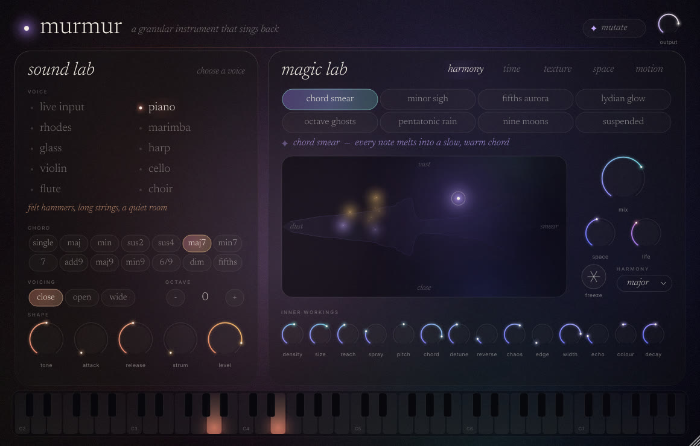

# vst3-test

Two plugins built with [JUCE](https://juce.com) 8, sharing one CMake project.

| Plugin | What it is | Formats |
| --- | --- | --- |
| **Murmur** | A granular instrument: synthesised live instruments on the left, a cloud of granular "spells" on the right | VST3 instrument, Standalone |
| **Murmur FX** | The same engine as an audio effect that granulates whatever track it sits on | VST3 effect (accepts MIDI) |
| **Simple Synth** | A small polyphonic subtractive synth | VST3, Standalone |

## Murmur



*a granular instrument that sings back.*

### Sound Lab: choose a voice

Nine instruments, all synthesised from scratch (no sample libraries), plus live input:

| Voice | How it's made |
| --- | --- |
| live input | the audio on the track (Murmur FX, or hosts that route audio into instruments) |
| piano | 16 inharmonic string partials with detuned unison pairs and a felt hammer |
| rhodes | FM tine with a fading bell bark |
| marimba | tuned wooden-bar modes (1 : 3.9 : 9.2) with a resonator tube |
| glass | struck-crystal modes, each slowly beating against a twin |
| harp | Karplus–Strong plucked string |
| violin, cello | band-limited bowed string through a resonant wooden body, delayed vibrato, bow noise |
| flute | breath noise tuned to the note, chiff on the attack |
| choir | three detuned voices through sung-vowel formants (tone morphs oo → oh → ah → ee) |

**One-finger chords**, in the spirit of chord instruments like the Orchid: pick a chord
shape (maj, min, sus2, sus4, maj7, min7, 7, add9, maj9, min9, 6/9, dim, fifths), a
voicing (close / open / wide) and a strum, and every key plays the whole chord.
Plus tone, attack, release, octave and level. Sustain pedal and pitch bend are supported.

### Magic Lab: cast a spell

A granular engine with a 16-second memory. Every grain can be transposed to a chord
tone, reversed, scattered in time and space, fed back into the memory and drowned in a
modulated 8-line reverb. Spells are complete settings: click one and every control
glides there over a second and a half, so you hear (and see) the sound transform.

40 spells in five families:

- **harmony**: chord smear, minor sigh, fifths aurora, lydian glow, octave ghosts, pentatonic rain, nine moons, suspended
- **time**: frozen breath, reverse bloom, tape memory, time smear, stutter dust, echo garden, slow motion, infinite sustain
- **texture**: glass rain, pollen, murmuration, velvet, sand, broken music box, whisper, cluster
- **space**: shimmer halo, cathedral swarm, underwater choir, moon tide, deep field, sub bloom, cloud chamber, northern hall
- **motion**: drift, orbit, pulse, tremolo dream, wind chimes, falling, rising, chaos garden

Then play with it:

- **The aura pad**: drag left for fine dust and right for long smears; drag down for close and up for vast
  (more feedback, space, detune and width). Every grain appears as a mote of light: height
  is pitch, distance from the left is how far back in memory it came from; gold motes are
  chord tones and rose ones are reversed. Double-click to recentre.
- **mix, space, life**: life sets how much slow random modulation keeps the sound moving.
- **freeze**: holds the memory still, so the cloud keeps singing what it last heard.
- **harmony**: the interval set grains are transposed into.
- **mutate**: nudges the current setting somewhere nearby.
- **Inner workings**: all 14 engine controls (density, size, reach, spray, pitch, chord
  amount, detune, reverse, chaos, edge, width, echo, colour, decay).

Spells are also exposed to the host as programs, and every control is automatable.

### Design

Ivory serif type (Newsreader) and small tracked sans labels (Inter) on a deep night
background. A warm coral aurora sits behind the Sound Lab and a cool violet one behind
the Magic Lab; both drift slowly and brighten with the sound. Glass panels, arcs of light
for knobs, a heart beside the name that pulses with the output. The window can be resized
(with the aspect ratio locked).

Both fonts are under the SIL Open Font License; see `Murmur/assets/fonts/`.

## Building

Requirements: CMake ≥ 3.22, a C++17 compiler, and Git (JUCE is fetched automatically).

On Linux, install the JUCE dependencies first:

```sh
sudo apt install libasound2-dev libx11-dev libxrandr-dev libxinerama-dev \
                 libxcursor-dev libxext-dev libfreetype-dev libfontconfig1-dev
```

Then:

```sh
cmake -S . -B build -DCMAKE_BUILD_TYPE=Release
cmake --build build --config Release -j
```

Outputs:

- `build/Murmur/Murmur_artefacts/Release/VST3/Murmur.vst3`
- `build/Murmur/MurmurFX_artefacts/Release/VST3/Murmur FX.vst3`
- `build/Murmur/Murmur_artefacts/Release/Standalone/`
- `build/SimpleSynth/SimpleSynth_artefacts/Release/VST3/Simple Synth.vst3`

Copy the `.vst3` bundles to your plugin folder (`~/.vst3` on Linux,
`C:\Program Files\Common Files\VST3` on Windows, `~/Library/Audio/Plug-Ins/VST3` on macOS)
and rescan in your DAW.

## Testing

```sh
ctest --test-dir build -C Release --output-on-failure
```

The Murmur test plays every instrument dry, runs every spell, granulates and freezes a
live input, round-trips state, and checks it renders well faster than real time. The test
binary can also render demos and screenshots:

```sh
MurmurTest --demo out.wav <spell> <instrument>   # e.g. 24 6 = shimmer halo on violin
MurmurTest --snapshot out.png [inst|fx] <spell> <instrument>
```

All three plugins pass [pluginval](https://github.com/Tracktion/pluginval) at strictness level 10.
