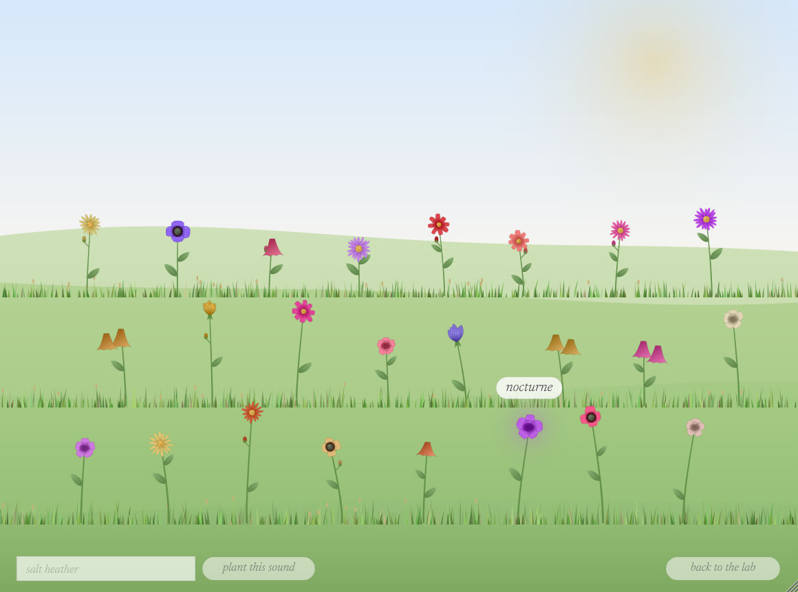

# vst3-test

Plugins built with [JUCE](https://juce.com) 8, sharing one CMake project. **macOS is the main platform.**

| Plugin | What it is | Formats |
| --- | --- | --- |
| **Bouquet** | A granular instrument: synthesised live instruments on the left, a cloud of granular "spells" on the right, and a garden that grows a bouquet for every chord | AU + VST3 instrument, standalone app |
| **Bouquet FX** | The same engine as an audio effect that granulates whatever track it sits on | AU (music effect) + VST3 effect |
| **Simple Synth** | A small polyphonic subtractive synth | AU, VST3, standalone |

## Install on a Mac

1. Open the repository's **Actions** tab on GitHub, open the newest green **Build** run, and download
   **Bouquet-macOS-installer** from its Artifacts.
2. Unzip it and open **Bouquet-macOS.pkg**. The installer isn't signed by a registered Apple developer,
   so the first time **right-click → Open** (or allow it in System Settings → Privacy & Security).
3. It installs Bouquet and Bouquet FX as Audio Units (`/Library/Audio/Plug-Ins/Components`) and VST3
   (`/Library/Audio/Plug-Ins/VST3`), plus the standalone app.
4. Rescan plug-ins in your DAW:
   - **Logic Pro / GarageBand**: they appear under Audio Units → VST3Test.
   - **Ableton Live**: Settings → Plug-Ins → turn on "Use Audio Units" (and/or the VST3 system folder),
     then Rescan. Put **Bouquet** on a MIDI track; put **Bouquet FX** on an audio track to granulate it.

The binaries are universal (Apple Silicon and Intel) and need macOS 11 or later. Every macOS CI run
passes Apple's `auval` validator for both Audio Units.

## Bouquet


### The garden

Every chord you play grows its own **bouquet** along the bottom of the window, rising out of the keys
you played through a strip of real-looking grass. It's unique to that chord: the notes, chord shape,
instrument and how hard you play decide which flowers grow (daisies, tulips, poppies, cosmos,
bellflowers, roses), how many, their colours (warm for major, lilac and blue for minor, rose for
suspended, plum for diminished) and the ribbon tying them. Flowers are drawn with shaded, veined
petals, seed discs, sepals, veined leaves and tapered stems.

The whole meadow **breathes in** when you play: the grass rises and straightens, the wind holds its
breath, and every chord sends a ripple through the blades. It breathes out when you stop.

When you let go, the bouquet **rots**, and it isn't pretty: petals bleed crimson and turn black, go
wet and glossy, shrivel and tear loose; blood runs down the stems into a pool; mould spreads over
the heads, leaves curl and blacken, stems collapse, and flies arrive. A long granular tail keeps
the bouquet alive a little longer.

### Presets: the meadow



Presets set the whole instrument at once: voice, chord, forest, and the Magic Lab (or its absence).
Click **garden** at the top left to walk into a sunny meadow where every preset is a flower. Names
appear only when you hover over a flower. Click one to load it (everything glides into place). To
save the sound you've made, name it (or keep the suggested name) and click **plant this sound**: a
new flower grows for it, unique to its settings. Right-click your own flowers to uproot them.

24 factory presets are included, and they are also the host's program list. Your own presets live
in `~/Library/Application Support/Bouquet/Presets` on a Mac.

### Recorded in a forest

The Sound Lab instruments sound as if recorded live in a forest clearing with a spaced pair of
microphones: sparse early reflections off tree trunks, a soft open-air tail, high frequencies
fading with distance, and a living ambience of wind in the leaves, rustles, distant birds and
insects. The ambience breathes in when you play and settles a few seconds after you stop, so
the plugin is silent when idle. **forest** sets how deep among the trees you are; **wildlife**
sets how much of the forest you hear around you. The Magic Lab granulates this field recording.

### The Magic Lab switch

**magic lab on/off** at the top bypasses the granular engine completely (it costs no CPU when off),
and the panel folds away so the Sound Lab and garden take the stage.

### Sound Lab: choose a voice

Nine instruments, all synthesised from scratch (no sample libraries), plus live input:

| Voice | How it's made |
| --- | --- |
| live input | the audio on the track (Bouquet FX, or hosts that route audio into instruments) |
| piano | 16 inharmonic string partials with detuned unison pairs and a felt hammer |
| rhodes | FM tine with a fading bell bark |
| marimba | tuned wooden-bar modes (1 : 3.9 : 9.2) with a resonator tube |
| glass | struck-crystal modes, each slowly beating against a twin |
| harp | Karplus–Strong plucked string |
| violin, cello | band-limited bowed string through a resonant wooden body, delayed vibrato, bow noise |
| flute | breath noise tuned to the note, chiff on the attack |
| choir | three detuned voices through sung-vowel formants (tone morphs oo → oh → ah → ee) |

**One-finger chords**, in the spirit of chord instruments like the Orchid: pick a chord
shape (maj, min, sus2, sus4, maj7, min7, 7, add9, maj9, min9, 6/9, dim, fifths), a
voicing (close / open / wide) and a strum, and every key plays the whole chord.
Plus tone, attack, release, forest, wildlife, octave and level. Sustain pedal and pitch bend are supported.

### Magic Lab: cast a spell

A granular engine with a 16-second memory. Every grain can be transposed to a chord
tone, reversed, scattered in time and space, fed back into the memory and drowned in a
modulated 8-line reverb. Spells are complete settings: click one and every control
glides there over a second and a half, so you hear (and see) the sound transform.

40 spells in five families:

- **harmony**: chord smear, minor sigh, fifths aurora, lydian glow, octave ghosts, pentatonic rain, nine moons, suspended
- **time**: frozen breath, reverse bloom, tape memory, time smear, stutter dust, echo garden, slow motion, infinite sustain
- **texture**: glass rain, pollen, murmuration, velvet, sand, broken music box, whisper, cluster
- **space**: shimmer halo, cathedral swarm, underwater choir, moon tide, deep field, sub bloom, cloud chamber, northern hall
- **motion**: drift, orbit, pulse, tremolo dream, wind chimes, falling, rising, chaos garden

Then play with it:

- **The aura pad**: drag left for fine dust and right for long smears; drag down for close and up for vast
  (more feedback, space, detune and width). Every grain appears as a mote of light: height
  is pitch, distance from the left is how far back in memory it came from; gold motes are
  chord tones and rose ones are reversed. Double-click to recentre.
- **mix, space, life**: life sets how much slow random modulation keeps the sound moving.
- **freeze**: holds the memory still, so the cloud keeps singing what it last heard.
- **harmony**: the interval set grains are transposed into.
- **mutate**: nudges the current setting somewhere nearby.
- **Inner workings**: all 14 engine controls (density, size, reach, spray, pitch, chord
  amount, detune, reverse, chaos, edge, width, echo, colour, decay).

Every control is automatable; the host's program list is the factory presets.

### Design

A bright day, with no title bar: serif type (Newsreader) and small tracked sans labels (Inter) in
warm charcoal on sunlit paper. Warm light (butter, peach, rose) drifts behind the Sound Lab and sky light (blue,
lilac, mint) behind the Magic Lab; both brighten with the sound. Frosted glass panels, arcs of
colour for knobs, a small sun beside the name that pulses with the output, and hand-drawn flowers.
The window can be resized (with the aspect ratio locked) and renders at full Retina sharpness.

Both fonts are under the SIL Open Font License; see `Bouquet/assets/fonts/`.

## Building

Requirements: CMake ≥ 3.22, a C++17 compiler, and Git (JUCE is fetched automatically).

On Linux, install the JUCE dependencies first:

```sh
sudo apt install libasound2-dev libx11-dev libxrandr-dev libxinerama-dev \
                 libxcursor-dev libxext-dev libfreetype-dev libfontconfig1-dev
```

Then:

```sh
cmake -S . -B build -DCMAKE_BUILD_TYPE=Release
cmake --build build --config Release -j
```

On a Mac, build universal and make the installer yourself (needs Xcode command-line tools):

```sh
cmake -S . -B build -DCMAKE_BUILD_TYPE=Release "-DCMAKE_OSX_ARCHITECTURES=arm64;x86_64"
cmake --build build --config Release -j
scripts/package-macos.sh build      # signs ad hoc, runs auval, writes build/Bouquet-macOS.pkg
```

Outputs (under `build/Bouquet/`):

- `Bouquet_artefacts/Release/AU/Bouquet.component`, `.../VST3/Bouquet.vst3`, `.../Standalone/Bouquet.app`
- `BouquetFX_artefacts/Release/AU/Bouquet FX.component`, `.../VST3/Bouquet FX.vst3`

On Windows, copy the `.vst3` bundles to `C:\Program Files\Common Files\VST3`; on Linux, to `~/.vst3`.

## Testing

```sh
ctest --test-dir build -C Release --output-on-failure
```

The Bouquet test plays every instrument dry, runs every spell, granulates and freezes a
live input, checks the note events the garden grows from (and that every chord gets its own
bouquet), round-trips state, and checks it renders well faster than real time. The test
binary can also render demos and screenshots:

```sh
BouquetTest --demo out.wav <spell> <instrument>   # e.g. 24 6 = shimmer halo on violin
BouquetTest --snapshot out.png [inst|fx] <spell> <instrument> [rot] [zoom]
```

All plugins pass [pluginval](https://github.com/Tracktion/pluginval) at strictness level 10.
